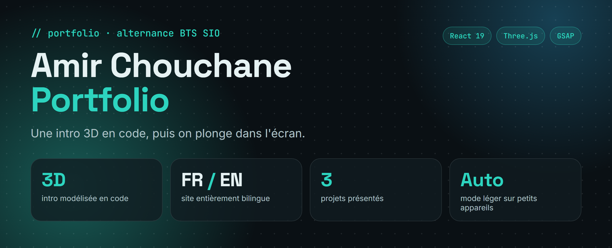
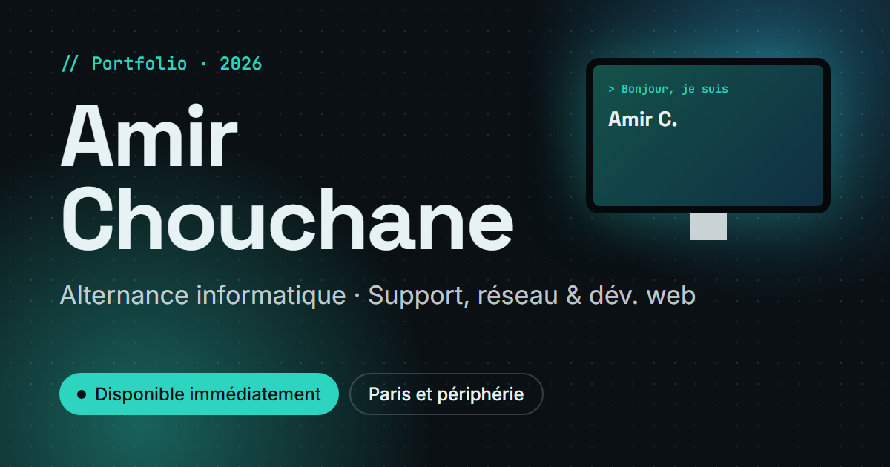

<p align="center">
  
</p>

<p align="center">
  <a href="https://amir-chouchane.vercel.app"></a>
  
  
  
  
</p>

> 👋 Le portfolio d'**Amir Chouchane**, étudiant en informatique.
> Je cherche une **alternance en support, réseau et développement web** (niveau Bac+2 / Bac+3), disponible immédiatement.

<p align="center"><b>🌐 <a href="https://amir-chouchane.vercel.app">amir-chouchane.vercel.app</a></b></p>



## ✨ Ce qu'il y a dedans

- 🖥️ **Intro en 3D** : un bureau modélisé en code (Three.js / React Three Fiber). En scrollant, on plonge dans l'écran
- 🎞️ **Animations au scroll** (GSAP, ScrollTrigger, Lenis) : texte qui s'éclaire ligne par ligne, cartes en éventail, mots géants, curseur personnalisé
- 🗂️ **Sections** : à propos, compétences, projets, parcours, CV (lecture et téléchargement), contact
- 🌍 **Français / anglais** : tous les textes sont dans `src/i18n/fr.json` et `src/i18n/en.json`
- 🪶 **Mode léger automatique** sur les appareils peu puissants ou les connexions lentes, et respect du réglage « réduire les animations »

## 🧩 Projets présentés

| | Projet | Technos |
| :---: | --- | --- |
| 🔎 | [Annuaire de codes de parrainage](https://github.com/Reiner916/codes-parrainage) | Next.js, React, TypeScript |
| 🧹 | Script de nettoyage des fichiers temporaires | Batch, Windows |
| 🤖 | [Bot de jeu par vision par ordinateur](https://github.com/Reiner916/7ds-grand-cross-story-bot) | Python, YOLO, ONNX, OpenCV |

## 🚀 Lancer le projet

```bash
npm install
npm run dev      # http://localhost:5173
npm run build    # version de production dans dist/
```

L'adresse publique du site se renseigne dans `.env` (`VITE_SITE_URL`) pour les aperçus de partage.

## 🛠️ Technologies

| | |
| --- | --- |
| Base | Vite, React 19, TypeScript |
| Style | Tailwind CSS 4 |
| Animations | GSAP (ScrollTrigger, SplitText), Lenis |
| 3D | Three.js, React Three Fiber |
| Hébergement | Vercel (déploiement automatique à chaque push) |

## 📁 Organisation

```
src/
├── components/   🖥️ Intro 3D, preloader, menu, curseur, cartes, effets
├── sections/     🗂️ À propos, compétences, projets, parcours, CV, contact
├── data/         📦 Contenu (compétences, projets, parcours, coordonnées)
├── i18n/         🌍 Textes en français et en anglais
└── lib/          ⚙️ Scroll fluide, chargement, mode léger, fond animé
public/           🖼️ CV en PDF, captures des projets, image de partage
og/               🪧 Source de l'image de partage
docs/             🎨 Bannière du README
```

## 📬 Contact

- ✉️ E-mail : [am.ch951@gmail.com](mailto:am.ch951@gmail.com)
- 💼 LinkedIn : [amir-chouchane](https://www.linkedin.com/in/amir-chouchane)
- 🐙 GitHub : [@Reiner916](https://github.com/Reiner916)
