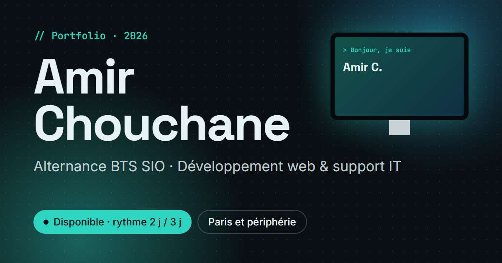

# Portfolio · Amir Chouchane

Portfolio personnel d'**Amir Chouchane**, étudiant en BTS SIO au CFA ITIS d'Évry-Courcouronnes, en recherche d'une alternance en développement web et support informatique (rythme 2 jours école / 3 jours entreprise).



## Ce qu'il y a dedans

- **Intro en 3D** : un bureau modélisé en code (Three.js / React Three Fiber) ; en scrollant, on plonge dans l'écran, dont le fond devient celui du site
- **Animations au scroll** (GSAP, ScrollTrigger, Lenis) inspirées de sites primés : texte qui s'éclaire ligne par ligne, cartes en éventail, mots géants qui défilent, curseur personnalisé
- Sections : à propos, compétences (niveaux sur 5), projets, parcours, CV (lecture et téléchargement), contact
- **Français / anglais** : tous les textes sont dans `src/i18n/fr.json` et `src/i18n/en.json`
- **Mode léger automatique** sur les appareils peu puissants ou les connexions lentes (image de la scène à la place de la 3D), respect du réglage « réduire les animations »

## Technologies

Vite · React 19 · TypeScript · Tailwind CSS 4 · GSAP · Lenis · Three.js · React Three Fiber

## Lancer le projet

```bash
npm install
npm run dev      # http://localhost:5173
npm run build    # version de production dans dist/
```

L'adresse publique du site se renseigne dans `.env` (`VITE_SITE_URL`) pour les aperçus de partage.

## Organisation

```
src/
├── components/   Intro 3D, preloader, menu, curseur, cartes, effets
├── sections/     À propos, compétences, projets, parcours, CV, contact
├── data/         Contenu (compétences, projets, parcours, coordonnées)
├── i18n/         Textes en français et en anglais
└── lib/          Scroll fluide, chargement, mode léger, fond animé
public/cv/        CV en PDF (+ aperçus générés à partir du PDF)
og/               Source de l'image d'aperçu de partage
```

## Contact

- E-mail : [am.ch951@gmail.com](mailto:am.ch951@gmail.com)
- LinkedIn : [amir-chouchane](https://www.linkedin.com/in/amir-chouchane)
- GitHub : [@Reiner916](https://github.com/Reiner916)
